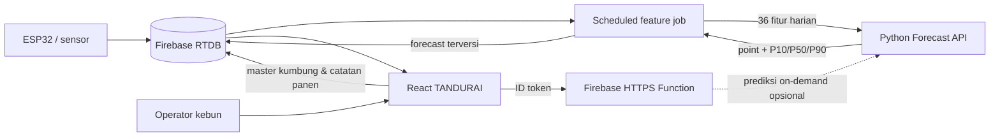

# Strategi Implementasi AI Forecast Panen pada Web TANDURAI

## 1. Ringkasan keputusan

Fitur AI yang paling siap diintegrasikan dari `Modul AI Aitoma` adalah **forecast total panen 7 hari per kumbung**, lengkap dengan rentang P10/P50/P90, confidence, dan rekomendasi batas aman komitmen pasokan.

Arsitektur yang direkomendasikan:

1. Model Python dijalankan sebagai **service inferensi terpisah** (container/Cloud Run), bukan di React atau Firebase Functions Node.js.
2. Firebase Realtime Database (RTDB) tetap menjadi sumber telemetry dan penyimpanan hasil forecast.
3. Proses terjadwal membentuk fitur harian, meminta prediksi ke AI service, lalu menyimpan hasilnya di RTDB.
4. React membaca hasil forecast dari RTDB dan menampilkannya pada halaman baru **AI Forecast**, serta ringkasan kecil pada Dashboard.
5. Model awal menggunakan artefak yang benar-benar tersedia: `histgradientboosting_reference.joblib` untuk point forecast dan `quantile_regression.joblib` untuk P10/P50/P90.

Status penting: seluruh benchmark model saat ini menggunakan data sintetis dan `field_validated=false`. Karena itu, versi awal wajib diberi label **Pilot / estimasi berbasis simulasi**, bukan klaim akurasi lapangan 90%.

## 2. Kondisi sistem saat ini

### Modul AI

Modul sudah memiliki:

- skema 36 fitur model (32 numerik dan 4 kategorikal);
- pipeline preprocessing yang ikut tersimpan di dalam artefak `joblib`;
- artefak point model dan quantile model;
- helper respons forecast pada `tandurai_harvest_ai/serving.py`;
- temporal split yang mencegah kebocoran data;
- protokol validasi dan gate pilot;
- Dockerfile dan dependensi Python.

Gap sebelum dapat disebut service produksi:

- belum ada HTTP API (FastAPI/Flask);
- belum ada loader model yang dijalankan sekali saat startup;
- belum ada pembentuk fitur produksi dari RTDB;
- Dockerfile saat ini menjalankan training, bukan web server inferensi;
- belum ada health check, auth service-to-service, versioning model, atau monitoring drift;
- `days_to_next_harvest` tercantum sebagai output produk, tetapi belum ada artefak model tersimpan untuk target tersebut;
- LightGBM, XGBoost, GRU, dan TFT belum dieksekusi pada artefak yang tersedia.

### Web `jamur`

Web saat ini menggunakan React/Vite, Firebase Authentication, RTDB, dan Firebase Functions Node.js. Data sensor utama berada pada:

- `tumbara/monitoring/sensor1`: nilai sensor terbaru;
- `tumbara/history`: snapshot telemetry yang disimpan maksimal sekali per menit;
- `tumbara/alerts`: status peringatan;
- `tumbara/system/sensor1`: status konektivitas perangkat.

Data yang sudah tersedia untuk model hanya suhu, kelembapan relatif, CO2, dan tekanan udara. Sebagian besar fitur budidaya dan label panen belum tersedia. Halaman Analytics dan Historical juga masih membangun cache dari perubahan nilai sensor terbaru; untuk AI, sumber yang benar harus berupa histori RTDB yang persisten.

Web juga sudah memiliki chatbot generatif pada Dashboard. Chatbot tersebut bukan model forecast panen dan perlu diperlakukan sebagai fitur terpisah.

## 3. Arsitektur target



Pemisahan tanggung jawab:

| Komponen | Tanggung jawab |
|---|---|
| React | input data operasional, memilih kumbung, menampilkan forecast, faktor risiko, status data, dan histori prediksi |
| RTDB | telemetry mentah, master data kumbung/batch, catatan panen, fitur harian, forecast, actual, dan metadata model |
| Firebase Functions | validasi akses pengguna, scheduler/orchestrator, pemanggilan AI service, penyimpanan hasil, alert kegagalan |
| Python AI service | validasi fitur, load artefak, inferensi point/quantile, confidence, dan health/model metadata |
| Training pipeline | retraining terpisah, evaluasi temporal, persetujuan/promosi model, dan publikasi artefak terversi |

## 4. Strategi data

### 4.1 Skema RTDB yang disarankan

```text
tumbara/
  farms/{farmId}/
    name
    timezone
  kumbungs/{kumbungId}/
    farmId
    name
    activeBatchId
  baglogBatches/{batchId}/
    kumbungId
    substrateType
    startedAt
    baglogCountActive
    growthStage
    contaminationRatePct
  monitoring/{kumbungId}/{sensorId}/
    temperature
    humidity
    co2
    pressure
    airflow
    substrateMoisture
    light
    fanStatus
    fanSpeedPct
    mistingStatus
    timestamp
  history/{kumbungId}/{pushId}/
    ...telemetry
  harvestEvents/{kumbungId}/{eventId}/
    harvestedAt
    batchId
    weightKg
    grade
    gradeAPct
    recordedBy
  aiFeaturesDaily/{kumbungId}/{yyyy-mm-dd}/
    ...36 fitur
    completenessPct
    sourceWindowEnd
    schemaVersion
  aiForecasts/{kumbungId}/latest/
    ...hasil forecast
  aiForecasts/{kumbungId}/history/{generatedAtKey}/
    ...hasil forecast
  aiActuals/{kumbungId}/{forecastDate}/
    actualNext7dKg
    absoluteErrorKg
```

Migrasikan path tunggal `sensor1` menuju struktur berbasis `kumbungId/sensorId`. Selama transisi, adapter dapat membaca path lama dan memetakannya ke `FARM-01-K01` agar UI lama tidak langsung rusak.

### 4.2 Pemetaan data aktual ke kebutuhan model

| Kelompok fitur | Sumber | Status sekarang | Tindakan |
|---|---|---|---|
| Suhu, RH, CO2, tekanan | sensor/history | sebagian tersedia | normalisasi nama dan unit; agregasi mean/min/max/std harian |
| Airflow, cahaya, kelembapan substrat | sensor | belum tersedia | tambah sensor atau isi null dengan indikator kelengkapan |
| Runtime fan dan misting | controller/history | status sesaat tersedia sebagian | simpan perubahan status dan hitung persentase runtime harian |
| Farm, kumbung, jenis substrat | master data | belum terstruktur | buat form dan master data |
| Jumlah/usia baglog, cycle day, growth stage | batch baglog | belum tersedia | buat lifecycle batch dan turunkan usia/cycle day dari tanggal mulai |
| Kontaminasi | input operator | belum tersedia | input berkala per batch/kumbung |
| Lag panen 1/3/7/14 hari | harvest events | belum tersedia | buat form pencatatan panen; hitung hanya dari tanggal sebelum prediksi |
| Stress hours dan rolling 7 hari | derived | belum tersedia | hitung di feature job dengan timezone Asia/Jakarta |

Jangan mengirim nilai nol untuk fitur yang tidak diketahui karena nol memiliki arti operasional. Gunakan `null`, biarkan pipeline model melakukan imputasi, dan tampilkan kualitas data kepada pengguna. Namun, kategori tidak boleh seluruhnya kosong; minimal farm, kumbung, growth stage, dan substrate type harus tersedia.

### 4.3 Gate kelayakan prediksi

Service hanya mengeluarkan forecast normal jika:

- terdapat minimal 7 hari telemetry untuk MVP, lalu 14 hari untuk produksi;
- kelengkapan telemetry utama minimal 90%;
- metadata batch aktif tersedia;
- timestamp sensor tidak stale;
- minimal riwayat panen yang diperlukan untuk lag telah dihitung secara eksplisit (nilai nol sah hanya jika tercatat tidak ada panen).

Jika belum memenuhi gate, respons memakai `status: "insufficient_data"` dan UI menampilkan daftar data yang kurang. Untuk demo integrasi, boleh menggunakan mode `synthetic_demo`, tetapi harus terlihat jelas dan tidak tercampur dengan data produksi.

## 5. Kontrak Forecast API

### 5.1 Endpoint internal

- `GET /healthz` — liveness.
- `GET /readyz` — memastikan kedua artefak berhasil dimuat.
- `GET /v1/model-info` — versi, tanggal latih, schema version, evidence scope, dan field validation.
- `POST /v1/predictions/harvest` — inferensi dari satu baris fitur tervalidasi.
- `GET /v1/kumbung/{kumbungId}/harvest-forecast?horizon=7` — opsional jika AI service diberi akses baca data; untuk pemisahan yang lebih aman, scheduler yang mengirim fitur lebih disarankan.

Contoh request internal:

```json
{
  "kumbung_id": "FARM-01-K01",
  "as_of_date": "2026-07-15",
  "schema_version": "harvest-features-v1",
  "features": {
    "farm_id": "FARM-01",
    "kumbung_id": "FARM-01-K01",
    "growth_stage": "fruiting",
    "substrate_type": "mixed_agri_waste",
    "baglog_count_active": 12000,
    "baglog_age_days": 45
  }
}
```

Objek `features` pada implementasi nyata harus memuat semua kolom di `FEATURE_COLUMNS`; nilai numerik yang tidak tersedia boleh `null` jika lolos gate kualitas data.

Contoh respons yang diperluas:

```json
{
  "status": "ok",
  "kumbung_id": "FARM-01-K01",
  "as_of_date": "2026-07-15",
  "generated_at": "2026-07-15T00:10:00Z",
  "horizon_days": 7,
  "forecast_kg": 126.4,
  "p10_kg": 103.0,
  "p50_kg": 124.8,
  "p90_kg": 151.2,
  "confidence": "medium",
  "supply_commitment_kg": 103,
  "data_quality": {
    "completeness_pct": 94.2,
    "missing_features": ["airflow_mean_ms"]
  },
  "model": {
    "point_version": "histgb-reference-2026-07-14",
    "quantile_version": "quantile-2026-07-14",
    "schema_version": "harvest-features-v1",
    "evidence_scope": "synthetic_benchmark",
    "field_validated": false
  }
}
```

Aturan respons:

- `forecast_kg` berasal dari point model terpilih;
- P10/P50/P90 berasal dari quantile bundle dan dipaksa monoton;
- `supply_commitment_kg = floor(P10)`;
- confidence mengikuti lebar interval relatif seperti helper yang sudah ada;
- model dimuat sekali saat startup, bukan pada setiap request;
- validasi request menggunakan Pydantic dan menolak kolom/tipe/schema version yang salah;
- `days_to_next_harvest` belum ditampilkan sampai model khusus target tersebut tersedia dan lolos validasi.

## 6. Implementasi backend

### 6.1 Python AI service

Tambahkan pada modul AI:

```text
tandurai_harvest_ai/
  api.py                 # FastAPI routes dan exception mapping
  inference.py           # singleton model loader + predict
  schemas.py             # Pydantic request/response
  risk_factors.py        # faktor risiko deterministik
  model_registry.py      # manifest/version/checksum artefak
tests/
  test_api.py
  test_inference.py
model_manifest.json
```

Ubah Dockerfile agar command produksi menjalankan `uvicorn`, gunakan `requirements-core.txt` ditambah FastAPI/Uvicorn, jalankan sebagai non-root, dan salin hanya runtime package serta artefak yang diperlukan. Training image/job sebaiknya dipisah dari serving image.

Faktor risiko MVP sebaiknya deterministik dan dapat diaudit, misalnya jumlah jam suhu stres, RH rendah, CO2 tinggi, kenaikan kontaminasi, dan telemetry stale. Feature importance/SHAP baru ditambahkan setelah model lapangan dipromosikan dan perilakunya diverifikasi.

### 6.2 Firebase Functions

Tambahkan fungsi berikut:

- `buildDailyHarvestFeatures`: terjadwal setiap hari pukul 00:05 Asia/Jakarta; agregasi telemetry hari sebelumnya dan fitur rolling/lag tanpa leakage.
- `generateDailyHarvestForecast`: terjadwal setelah feature job; panggil AI service untuk semua kumbung aktif, lalu simpan `latest` dan `history` secara atomik.
- `refreshHarvestForecast`: callable/HTTPS untuk refresh manual, dilindungi Firebase ID token, App Check, role, dan rate limit.
- `backfillForecastActuals`: hitung actual panen t+1..t+7 setelah horizon selesai agar monitoring error dapat dilakukan.

Gunakan Secret Manager/parameterized secrets untuk URL/token service. Jangan menaruh credential di source code, `.env.example`, atau bundle Vite.

### 6.3 Keamanan yang harus dikerjakan sebelum integrasi

Audit menemukan credential API nyata tersimpan di frontend dan file contoh environment. Credential tersebut harus segera dicabut/dirotasi, dihapus dari riwayat Git bila pernah di-commit, dan seluruh panggilan API generatif dipindahkan ke backend. Browser tidak boleh memegang secret.

Tambahkan juga:

- RTDB Security Rules berbasis `auth.uid`, farm membership, dan role;
- Firebase App Check untuk web dan callable functions;
- service-to-service authentication untuk AI service;
- batas ukuran payload, timeout 10–15 detik, retry dengan exponential backoff, dan idempotency key per kumbung/tanggal/model;
- log tanpa credential atau data pribadi.

## 7. Implementasi frontend

### 7.1 Navigasi dan halaman

Tambahkan route `/ai-forecast`, item sidebar **AI Forecast**, dan komponen:

```text
src/
  pages/AIForecastPage.jsx
  components/ai/ForecastSummaryCard.jsx
  components/ai/ForecastRangeChart.jsx
  components/ai/ForecastFactors.jsx
  components/ai/DataQualityPanel.jsx
  components/ai/ForecastHistoryTable.jsx
  hooks/useHarvestForecast.js
  services/forecastService.js
```

Tampilan utama:

1. pemilih farm/kumbung;
2. kartu “Potensi panen 7 hari” (`forecast_kg`);
3. rentang aman P10–P90 dalam range bar/chart;
4. “Komitmen pasokan disarankan” menggunakan P10;
5. badge confidence dan kualitas data;
6. faktor risiko dengan data pendukung;
7. histori forecast vs aktual;
8. timestamp pembaruan, versi model, dan label evidence scope.

Pada Dashboard, tambahkan kartu ringkas forecast yang menautkan ke halaman lengkap. Gunakan skeleton saat loading, state kosong untuk data belum cukup, state stale jika forecast lebih lama dari 26 jam, dan pesan error dengan tombol retry.

### 7.2 Copy yang aman

Selama model belum tervalidasi lapangan:

- gunakan “Estimasi AI (pilot)”;
- tampilkan “Model masih menggunakan benchmark sintetis; gunakan sebagai bantuan perencanaan, bukan jaminan panen”;
- jangan tampilkan “akurasi 90,86%” sebagai akurasi kebun nyata;
- jangan menyamakan confidence interval dengan probabilitas panen pasti.

### 7.3 Hubungan dengan chatbot yang sudah ada

Forecast model harus menjadi sumber angka resmi. Chatbot hanya boleh menjelaskan payload forecast yang sudah tersimpan, tidak menghitung atau mengarang angka panen. Alur aman:

1. backend mengambil forecast terbaru dan status sensor;
2. backend membentuk prompt terstruktur;
3. LLM menyusun penjelasan/rekomendasi bahasa alami;
4. UI memberi label “Penjelasan generatif” dan tetap menampilkan angka sumber.

## 8. Tahapan delivery

### Fase 0 — keamanan dan fondasi (prioritas segera)

- rotasi dan pindahkan seluruh credential ke backend/Secret Manager;
- tambahkan RTDB rules dan App Check;
- tetapkan `farmId`, `kumbungId`, `sensorId`, timezone, dan data owner;
- buat model manifest dan bekukan kontrak `harvest-features-v1`.

Kriteria selesai: tidak ada secret di bundle/source; akses RTDB lintas farm ditolak; kontrak data disepakati.

### Fase 1 — demo end-to-end terkontrol

- bungkus dua artefak yang tersedia dalam FastAPI;
- deploy container AI;
- buat endpoint/proxy Firebase dan `AIForecastPage`;
- gunakan satu record `daily_model_table.csv` atau fitur synthetic demo;
- tampilkan label pilot/synthetic secara permanen.

Kriteria selesai: pengguna login dapat memilih satu kumbung demo, melihat forecast lengkap, dan error/insufficient data tertangani. Ini membuktikan integrasi, bukan performa lapangan.

### Fase 2 — pengumpulan data lapangan

- implementasikan master farm/kumbung/batch;
- simpan telemetry persisten per kumbung;
- buat form panen wajib: waktu, berat, grade, batch;
- buat input kontaminasi dan perubahan growth stage;
- jalankan feature job dan dashboard kualitas data.

Kriteria selesai: telemetry minimal 90% lengkap dan setiap event panen dapat ditelusuri ke batch serta kumbung.

### Fase 3 — shadow prediction dan validasi

- jalankan forecast otomatis tanpa dipakai untuk komitmen bisnis;
- simpan setiap prediksi sebelum actual terjadi;
- evaluasi temporal WAPE, MAE, coverage, dan subgroup WAPE;
- kalibrasi P10–P90 dan bandingkan kandidat LightGBM/XGBoost/GRU/TFT hanya jika benar-benar dieksekusi.

Gate promosi yang disarankan modul:

- WAPE <= 20%;
- MAE <= 10% dari rata-rata panen 7 hari;
- coverage P10–P90 antara 75% dan 85%;
- subgroup WAPE <= 30% untuk subgroup dengan volume memadai;
- minimal 10 kumbung, minimal 5 mitra, dan 2–3 siklus/flush per kumbung.

### Fase 4 — produksi bertahap

- aktifkan rekomendasi P10 untuk perencanaan pasokan;
- canary ke beberapa kumbung, lalu perluas jika stabil;
- tambahkan alert forecast stale/failed dan data drift;
- tetapkan jadwal retraining, approval, rollback, dan retensi model;
- baru pertimbangkan penjelasan SHAP dan model deep learning setelah melewati baseline lapangan.

## 9. Pengujian dan observabilitas

### Pengujian

- unit: agregasi harian, rolling/lag anti-leakage, validation schema, confidence, P10 <= P50 <= P90;
- contract: request Firebase ↔ FastAPI dan response ↔ React;
- integration: RTDB Emulator + Functions Emulator + AI container;
- UI: loading, success, insufficient data, stale, unauthorized, service unavailable;
- model regression: golden feature row menghasilkan output dalam toleransi yang ditetapkan;
- security: user tanpa role/farm membership tidak dapat membaca/refresh forecast;
- load: forecast seluruh kumbung selesai di dalam jendela scheduler.

### Metrik operasional

- request count, latency p50/p95, error rate, dan cold start;
- umur forecast terbaru;
- feature completeness dan sensor freshness;
- distribusi input, missing rate, dan out-of-range rate;
- WAPE/MAE/coverage rolling setelah actual tersedia;
- perbedaan performa per farm/kumbung/growth stage;
- versi model dan schema untuk setiap prediksi.

## 10. Urutan backlog teknis

| Prioritas | Item | Lokasi utama | Estimasi relatif |
|---:|---|---|---:|
| P0 | Rotasi secret dan pindahkan chatbot/API eksternal ke backend | `apps/web`, `functions` | S |
| P0 | Model manifest + FastAPI inference + tests | `Modul AI Aitoma` | M |
| P0 | Docker serving image + health/readiness | `Modul AI Aitoma` | S |
| P1 | Skema RTDB multi-kumbung + rules | `jamur`/Firebase | M |
| P1 | Master kumbung/batch dan form harvest event | `apps/web` | L |
| P1 | Feature builder harian leakage-safe | `functions` atau data job Python | L |
| P1 | Scheduler forecast + persistence + retry | `functions` | M |
| P1 | AI Forecast page + dashboard summary | `apps/web` | M |
| P2 | Actual reconciliation + model monitoring | backend/web | M |
| P2 | Pilot lapangan dan kalibrasi interval | data/operasional | L |
| P3 | Registry, canary, retraining, rollback | MLOps | L |

S = kecil, M = menengah, L = besar; estimasi kalender perlu disesuaikan dengan jumlah engineer, kesiapan perangkat, dan proses operasional pencatatan panen.

## 11. Definisi selesai untuk MVP

MVP dianggap selesai jika:

1. user login hanya dapat melihat kumbung yang diizinkan;
2. kedua artefak model dimuat satu kali dan readiness gagal jika artefak/schema tidak cocok;
3. satu forecast per kumbung/tanggal/model bersifat idempotent dan tersimpan lengkap dengan versi;
4. UI menampilkan forecast, P10/P50/P90, confidence, P10 commitment, kualitas data, dan timestamp;
5. insufficient/stale/error state tersedia;
6. tidak ada credential di frontend;
7. automated tests untuk kontrak utama lulus;
8. label synthetic/pilot tidak dapat hilang selama `field_validated=false`;
9. dashboard tidak menampilkan `days_to_next_harvest` sebelum modelnya tersedia;
10. forecast dan actual tersimpan sehingga validasi lapangan dapat dilakukan tanpa hindsight/leakage.

## 12. Rekomendasi pilihan implementasi

Mulai dengan **FastAPI + Cloud Run + Firebase scheduler/orchestrator + RTDB output cache**. Pola ini paling cocok dengan model Python yang sudah ada, menghindari pemuatan scikit-learn di browser/Node.js, menjaga secret di backend, dan memungkinkan React tetap sederhana serta realtime.

Jangan mulai dari GRU/TFT atau chatbot. Nilai produk tercepat berasal dari membenahi data operasional, mengaktifkan artefak tree + quantile yang tersedia sebagai pilot, lalu membuktikan performa pada data lapangan sebelum meningkatkan kompleksitas model.
