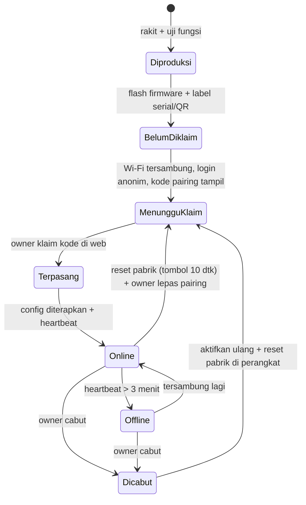
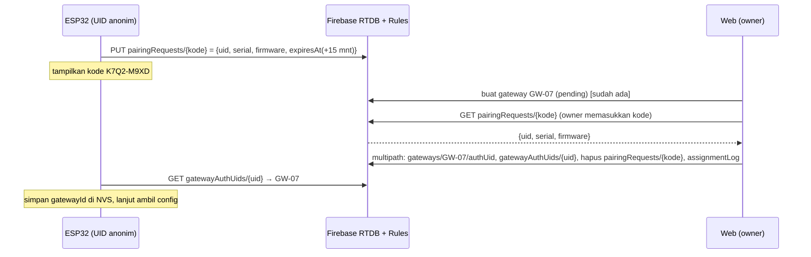
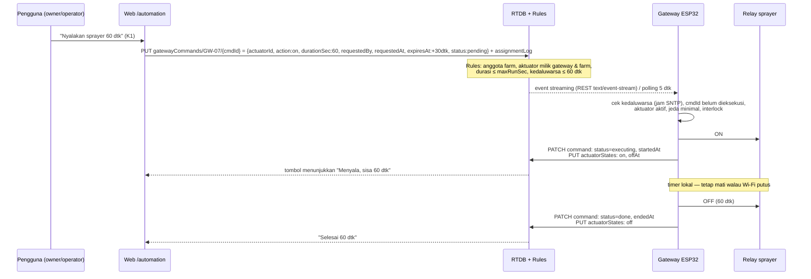

# Konsep Integrasi Hardware: dari Perangkat Baru sampai Kontrol Aktuator

**Status:** Digantikan sebagian oleh [`rencana-integrasi-iot-gateway.md`](./rencana-integrasi-iot-gateway.md) (pairing UID hardware + kode klaim + device secret, capabilities otomatis, `commandResults`, mode Manual/Timer/Auto) dan [`../PANDUAN_INTEGRASI_HARDWARE.md`](../PANDUAN_INTEGRASI_HARDWARE.md). Dokumen ini disimpan sebagai latar belakang.  
**Tanggal:** 2026-10-15  
**Dasar:** arsitektur yang sudah berjalan — Firebase Anonymous Auth per gateway, pairing oleh owner, `gatewayConfigs` bervesi, ack per sensor, RTDB Rules sebagai satu-satunya penjaga, **tanpa server**. Lihat [`implementasi-hirarki-manajemen-sensor.md`](./implementasi-hirarki-manajemen-sensor.md) dan [`simulasi-gateway-esp32-firebase.md`](./simulasi-gateway-esp32-firebase.md).

## 1. Ringkasan alur

```text
Produksi → Flash firmware → Pasang di farm (Wi-Fi) → Login anonim → Kode pairing
→ Owner klaim di web → Owner tugaskan sensor + aktuator → Gateway terapkan config
→ Telemetry + status aktuator ke web → Pengguna kirim perintah (mis. sprayer 60 dtk)
→ Gateway eksekusi + mati otomatis → Ack + status → Riwayat audit
```

Prinsip yang tidak berubah:

1. **Gateway hanya mengikuti config dan perintah yang ditulis di Firebase**; tidak ada kredensial owner/admin di perangkat.
2. **Keselamatan aktuator ada di perangkat**, bukan di cloud: batas durasi, mati otomatis, default mati saat boot, tetap aman saat offline.
3. **Setiap perintah punya ID, kedaluwarsa, dan ack**, sehingga retry tidak menyalakan dua kali dan perintah basi tidak dieksekusi.

## 2. Kondisi saat ini

| Bagian | Kondisi |
|---|---|
| Registrasi gateway, pairing UID, cabut/aktifkan ulang | Ada (`/devices`). Pairing masih dengan **mengetik UID panjang**. |
| Sensor: tugaskan, config bervesi, ack, telemetry | Ada; diuji dengan simulator. |
| Telemetry status aktuator | Field `mistingStatus`, `fanStatus`, `fanSpeedPct` sudah ada di `telemetry-v1`. |
| Kontrol aktuator | **Belum ada.** Tombol sprayer/fan/pump/humidifier di `AutomationPage` hanya mengubah state lokal browser, tidak mengirim apa pun. |
| Firmware ESP32 | Belum ada; perilaku dicontohkan oleh `tools/gateway-simulator.mjs`. |

## 3. Siklus hidup perangkat



## 4. Tahap 1 — Produksi dan flash firmware

Dilakukan oleh tim/teknisi sebelum perangkat dikirim.

1. **Rakit dan uji:** ESP32 + sensor (protokol bus ditentukan saat hardware dipilih) + modul relay untuk aktuator.
2. **Flash firmware** yang sama untuk semua unit. Firmware hanya berisi nilai **non-rahasia**: Firebase Web API key, URL RTDB, URL Auth. Tidak ada password, service account, atau token.
3. **Identitas pabrik:** nomor seri diambil dari MAC/eFuse ESP32 (mis. `TDR-24A1B2C3`). Cetak label + QR berisi nomor seri.
4. **Uji akhir pabrik** (opsional): mode uji yang menyalakan tiap relay 1 detik dan membaca sensor, lalu **hapus NVS** sehingga perangkat keluar pabrik dalam keadaan belum diklaim.
5. Aktifkan **Secure Boot + Flash Encryption** bila proses produksi siap (melindungi refresh token di NVS).

Catatan hardware aktuator (keselamatan listrik):

- Relay dengan optocoupler; beban sprayer (pompa/solenoid 12–24 V) dari catu daya terpisah dengan sekring; dioda flyback untuk beban induktif.
- Pin relay **aktif-tinggi dan default LOW saat boot** agar sprayer tidak menyala saat ESP32 restart.
- Saklar manual fisik (override) dan tombol reset pabrik (tekan 10 detik).

## 5. Tahap 2 — Instalasi di farm dan koneksi

1. Perangkat menyala tanpa Wi-Fi tersimpan → membuka **mode setup**: access point `TANDURAI-XXXX` + captive portal (atau BLE provisioning).
2. Installer memilih SSID dan memasukkan password Wi-Fi lewat ponsel. Disimpan di NVS.
3. Perangkat tersambung, sinkron waktu (SNTP), lalu **login Firebase Anonymous Auth** sekali (`accounts:signUp`) dan menyimpan UID + refresh token di NVS (sudah sama dengan simulator).

## 6. Tahap 3 — Klaim/pairing dengan kode pendek (perbaikan dari alur saat ini)

Mengetik UID 28 karakter rawan salah. Diusulkan **kode pairing 8 karakter** yang ditampilkan perangkat (LED/OLED, serial, atau halaman captive portal), misalnya `K7Q2-M9XD`.



Aturan yang dibutuhkan:

- `pairingRequests/{kode}`: ditulis **hanya oleh UID anonim itu sendiri** (`newData.uid === auth.uid`), kode 8 karakter dari alfabet tanpa huruf ambigu (32^8 ≈ 10^12 kombinasi), `expiresAt` maksimal 15 menit; tidak bisa ditimpa perangkat lain; dibaca per key oleh user login (tidak bisa di-list).
- Pairing tetap divalidasi Rules pairing yang sudah ada (owner farm, gateway `pending`, UID belum dipakai, UID bukan akun manusia) **ditambah** syarat UID sama dengan `pairingRequests/{kode}/uid` dan belum kedaluwarsa.
- Nomor seri ikut tersimpan di `gateways/{id}/serial` untuk garansi dan audit.
- **Perangkat tidak lagi butuh gatewayId diketik saat commissioning**; ia membacanya dari `gatewayAuthUids/{uid}` setelah diklaim.

Alur lama (ketik UID) tetap ada sebagai cadangan.

## 7. Tahap 4 — Konfigurasi sensor dan aktuator

### 7.1 Model data aktuator (baru)

```text
tumbara/actuators/{actuatorId}/
  farmId, kumbungId, gatewayId
  name: "Sprayer Kumbung 1"
  type: "sprayer" | "fan" | "humidifier" | "light"
  channel: "relay:1"            # alamat lokal di gateway
  maxRunSec: 120                # batas keras satu kali nyala
  minIntervalSec: 300           # jeda minimal antar-nyala (cegah banjir)
  status: "pending" | "active" | "inactive"

tumbara/kumbungActuators/{kumbungId}/{actuatorId}: true
tumbara/gatewayActuators/{gatewayId}/{actuatorId}: true

tumbara/gatewayConfigs/{gatewayId}/actuators/{actuatorId}/   # bagian config bervesi
  kumbungId, type, channel, maxRunSec, minIntervalSec, enabled
```

Penugasan aktuator **memakai mekanisme yang sama dengan sensor**: multipath update oleh owner, `configVersion` naik +1, gateway menerapkan, ack per aktuator (`gatewayAcks/{gw}/actuators/{id}: ok | not_found | fault`), status `pending → active` hanya oleh gateway.

### 7.2 UI

- `/devices` → tab **Aktuator** per kumbung: tambah/ubah/nonaktifkan, pilih gateway dan kanal relay, atur batas durasi.
- Kartu gateway menampilkan aktuator bermasalah dari ack.

## 8. Tahap 5 — Telemetry dan status aktuator

- Sensor: tetap `telemetry-v1` per sensor (sudah berjalan).
- Aktuator: gateway menulis status nyata ke
  ```text
  tumbara/actuatorStates/{gatewayId}/{actuatorId}/
    state: "on" | "off" | "fault"
    since: 1791507600000
    source: "command" | "automation" | "manual" | "failsafe"
    commandId: "..."            # bila dipicu perintah
    offAt: 1791507660000         # jadwal mati otomatis bila sedang menyala
  ```
  Ditulis saat berubah dan bersama heartbeat. **Web menampilkan status dari node ini**, bukan dari tombol yang diklik, sehingga yang terlihat adalah kondisi relay sebenarnya (termasuk bila saklar manual dipakai).

## 9. Tahap 6 — Push action: menyalakan sprayer

### 9.1 Alur perintah



### 9.2 Model perintah

```text
tumbara/gatewayCommands/{gatewayId}/{commandId}/
  # ditulis web (owner/operator)
  actuatorId: "ACT-K1-SPRAY"
  action: "on" | "off" | "all_off"
  durationSec: 60               # wajib untuk "on"; ≤ maxRunSec aktuator
  requestedBy: "{uid}"          # = auth.uid
  requestedAt: 1791507600000    # ±1 menit dari waktu server
  expiresAt: 1791507630000      # ≤ requestedAt + 60 dtk
  # ditulis gateway (field terpisah, divalidasi Rules)
  status: "pending" | "executing" | "done" | "rejected" | "expired" | "failed"
  startedAt, endedAt, reason
```

Rules:

- **Web:** hanya membuat perintah baru (`!data.exists()`), anggota farm gateway (owner/operator), aktuator `active` milik gateway itu dan farm yang sama, `durationSec` ≤ `maxRunSec`, waktu wajar; tidak bisa mengubah perintah yang sudah ada. Setiap perintah juga menulis `assignmentLog` (`actuator_command`).
- **Gateway:** hanya gateway pemilik (UID terpasang, tidak dicabut) yang membaca perintahnya dan mengubah **hanya** field status/waktu/alasan, dengan transisi maju (`pending → executing → done/failed`, atau `pending → rejected/expired`).
- Perintah `all_off` (stop darurat) tidak bisa ditolak karena jeda minimal.

### 9.3 Keselamatan di perangkat (wajib, tidak bergantung cloud)

| Aturan | Perilaku |
|---|---|
| Default mati | Relay LOW saat boot/reset; perintah yang tertunda **tidak** dieksekusi ulang setelah reboot (cek `expiresAt`). |
| Mati otomatis | Setiap "on" punya timer lokal = `min(durationSec, maxRunSec)`; mati walau koneksi putus. |
| Idempoten | `commandId` yang sudah dieksekusi disimpan (ring buffer 50 ID); event ganda tidak menyalakan dua kali. |
| Kedaluwarsa | Perintah dengan `expiresAt` lewat → status `expired`, tidak dieksekusi. Butuh jam SNTP valid; tanpa jam valid, perintah ditolak. |
| Jeda minimal | Tolak "on" bila belum lewat `minIntervalSec` sejak nyala terakhir (`rejected: interval`). |
| Interlock (opsional) | Tolak sprayer bila RH > 95% atau sensor kumbung tidak terbaca > 3 menit. |
| Watchdog | Hardware watchdog; bila firmware macet, ESP32 restart → relay mati. |
| Manual override | Saklar fisik menang; status `source: manual` dilaporkan. |

### 9.4 Latensi

- RTDB REST **streaming** (`Accept: text/event-stream` pada `gatewayCommands/{gatewayId}`) memberi latensi < 1–2 detik.
- Bila streaming putus: polling tiap 5 detik + reconnect dengan backoff. Perintah tetap aman karena punya kedaluwarsa.

## 10. Tahap 7 — Otomasi di tepi (edge)

Aturan otomatis (mis. "semprot 30 dtk bila RH < 75% selama 5 menit, jeda 10 menit, hanya 06:00–18:00") disimpan sebagai bagian config:

```text
tumbara/gatewayConfigs/{gatewayId}/automation/{ruleId}/
  actuatorId, sensorId, metric: "humidity", below: 75, sustainSec: 300,
  runSec: 30, cooldownSec: 600, activeHours: "06-18", enabled: true
```

- Dieksekusi **di gateway**, jadi tetap berjalan saat internet putus.
- Diubah dari web → `configVersion` naik → gateway menerapkan dan mengakui (mekanisme Fase 3).
- Setiap aksi otomatis dilaporkan di `actuatorStates` (`source: automation`). Halaman Automation menggantikan "Kebijakan" statis yang sekarang dengan editor aturan ini.

## 11. Pemeliharaan dan akhir masa pakai

| Kejadian | Alur |
|---|---|
| Ganti perangkat rusak | Lepas pairing → klaim perangkat baru dengan kode → config dan aktuator tetap milik gateway ID yang sama. |
| Pindah farm | Cabut di farm lama; reset pabrik; klaim sebagai gateway baru di farm tujuan (gateway tidak bisa pindah farm). |
| Update firmware (OTA) | Konsep lanjutan: `gatewayConfigs/{gw}/firmware = {version, url, sha256}`; perangkat unduh, verifikasi tanda tangan, rollback otomatis bila gagal boot. Perlu hosting file (Firebase Storage) — dibahas terpisah. |
| Dekomisioning | Cabut → reset pabrik (hapus NVS) → riwayat telemetry tetap tersimpan. |

## 12. Rencana implementasi bertahap

| Tahap | Isi | Bisa dikerjakan sebelum hardware? | Selesai bila |
|---|---|---|---|
| **H1** Aktuator di katalog | Model `actuators` + indeks + `gatewayConfigs/actuators`, Rules, UI tab Aktuator, ack aktuator | Ya (simulator dengan relay tiruan) | Owner menambah sprayer ke kumbung; gateway sim mengakui; status `active`. |
| **H2** Perintah + status | `gatewayCommands`, `actuatorStates`, Rules, tombol Automation memakai perintah nyata, streaming di simulator | Ya | Klik "Nyalakan 60 dtk" → sim menyala, mati otomatis, status & ack tampil < 2 dtk; perintah basi/ganda/melebihi batas ditolak. |
| **H3** Kode pairing | `pairingRequests`, UI "Klaim dengan kode", serial di registry | Ya | Simulator menampilkan kode; owner klaim tanpa mengetik UID. |
| **H4** Otomasi edge | Aturan di config, evaluasi di simulator, editor di Automation | Ya | Aturan RH memicu sprayer di simulator walau "offline". |
| **H5** Firmware nyata | Wi-Fi provisioning, Auth/RTDB REST + streaming, NVS, relay + timer + watchdog, adapter sensor | **Butuh hardware** | Satu ESP32 + 1 sensor + 1 relay di bench: semua uji H1–H4 lulus pada perangkat. |
| **H6** Pilot | Satu kumbung nyata, pemantauan 1–2 minggu | Butuh hardware | Tidak ada nyala tak terduga; semua perintah ter-ack; telemetry stabil. |

Setiap tahap mengikuti pola yang sudah terbukti: modul pembangun update murni, Rules dengan uji allow/deny di emulator, simulator e2e, lalu UI.

## 13. Keputusan yang dibutuhkan

1. **Model hardware:** ESP32 varian apa, sensor apa (protokol bus), dan relay/aktuator apa (sprayer = pompa atau solenoid? tegangan?). Menentukan H5.
2. **Siapa boleh mengirim perintah:** usulan owner **dan** operator (sesuai role "menjalankan operasi farm"); stop darurat untuk semua anggota.
3. **Batas default:** usulan sprayer `maxRunSec` 120, `minIntervalSec` 300; fan `maxRunSec` 3600.
4. **Media kode pairing:** layar OLED kecil, halaman captive portal, atau hanya serial (paling murah).
5. **Mulai dari H1–H2 dengan simulator sekarang?** Semua bisa diuji penuh tanpa hardware dan langsung dipakai firmware nanti.
